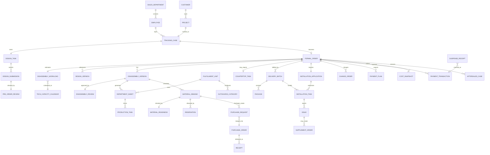
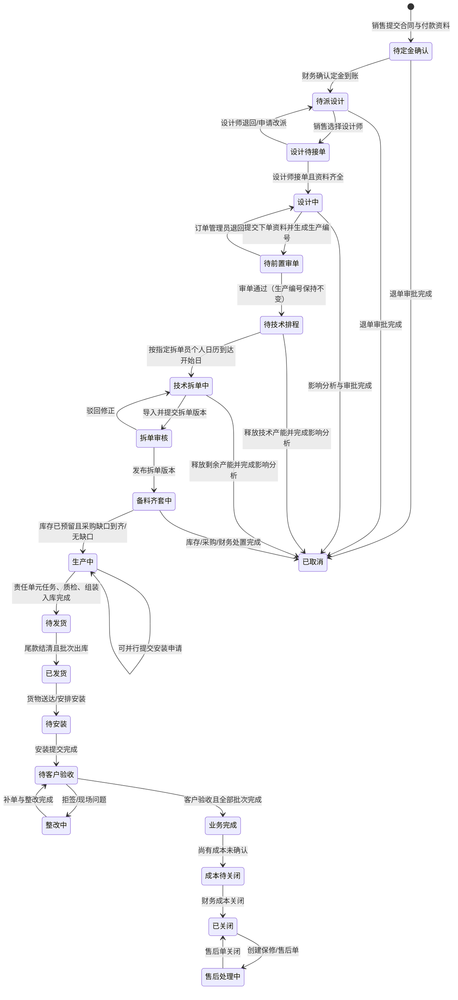
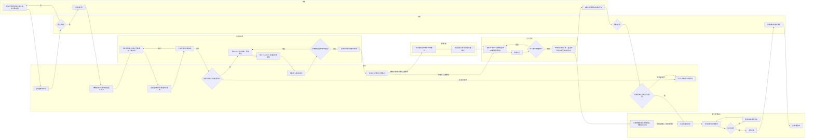
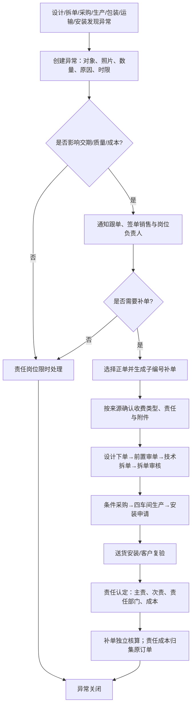
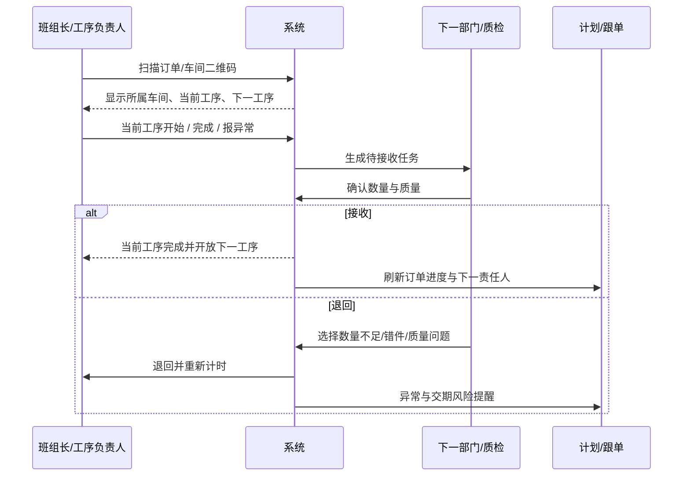
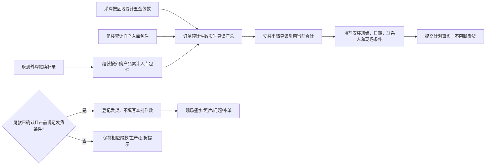

# 全屋定制家具订单跟单系统｜产品蓝图 V1.0

> 依据《全屋定制家具 ERP 需求分析与实施蓝图 V3.0》、黑湖小工单界面参考、板件料单样图及三轮需求评审形成。本文以订单跟单为范围，不建设门店经营、客户门户、完整 MES 或财务总账。

## A. 产品需求评审结果

### 产品定位

系统是公司内部的订单跟单控制台。业务从销售提交已签合同和定金资料开始，贯穿设计与生产编号生成、前置审单、技术产能排程与拆单、拆单审核、库存/余料齐套核对、条件采购、生产执行、尾款核对、安装申请、发货安装、客户验收、整改补单、售后与成本关闭。

### 已纠正的原方案问题

1. 不再用一个线性“订单状态”同时表达设计、付款、风险和售后；改为主履约阶段加并行状态。
2. 正式订单号生成前仍有业务活动，因此增加不可变的跟单流水号。
3. 销售订单按整套项目总价记录；BOM 和部门料单属于工程执行层，不是销售订单项。
4. 海迅首期不依赖 API；以结构化文件导入、校验、复核、版本发布为主。
5. 工人扫码报备不直接等于完工；采用“申请交付—确认接收”的双向生产交接。
6. 发货不是订单终点；安装、验收、整改补单是主履约组成部分。
7. 业务完成和成本关闭分离，避免安装完成但成本尚未归集时错误锁死毛利。
8. 采购是缺料后的条件分支，不是所有订单的固定阶段；采购工作台仍是一级职能，只聚合存在采购需求的订单。
9. 旧台账把多笔收款横向铺在一行；新系统改为“付款计划 + 多笔收款流水 + 待认领收款”，自动汇总实收和余款。
10. 权限落实到字段层：车间工人不见合同总价、实收、余款、采购价、成本和毛利；毛利只对财务与董事长管理员可见。
11. 设计师“交图”与“下单”不是同一状态；设计师正式提交下单资料时生成生产编号，再由订单管理员前置审单。退回设计修改时保留生产编号，通过后进入技术排程。
12. 技术拆单不是固定 1 天。当前按合同金额折算工作量，默认每 6 万元占用拆单员个人 1 个技术工作日；周末跳过，同一拆单员的多张订单连续顺排且日期不得重叠。
13. 技术拆单后仍需第二次拆单审核；前置审单与拆单审核是两个不同责任点，不能合并成一个“复核”。
14. 生产只划分为板式车间、木工（实木）车间、油漆车间、组装车间；每个车间按正式工序模板逐项报备，不能只填写“是否完成”。
15. 外购是开放分类，不把成品、铝框门/玻璃、艾格门板、台面写死成部门；分类可新增、停用和配置负责人。
16. 发货的财务门禁只有尾款确认。安装申请是计划与统计事实，不再阻断发货；定制产品仍须相应生产区域完工，外购产品仍须实际到货齐套。
17. 四车间生产、五金和外购仍保留进度与缺口提醒，但只作为履约准备信息，不作为送货系统门禁。
18. 流程节点记录不能代替任务交互：销售签约表单、设计师图纸提交、订单管理员前置审单和台面外购处理必须有角色专属操作入口。
19. 安装问题、客户临时加项及设计/生产责任问题均创建独立补单；补单自动关联正单，生产编号为 `补单-BYYMMCSSS`，并完整经过设计、审单、拆单、生产、安装申请和交付流程。
20. 实际完成时间晚于计划时间时，状态仍为“已完成”，但必须同时保留并显示“延期 N 天”，用于绩效与复盘。
21. 技术发现图纸无法拆单时不能覆盖设计原图；必须生成独立技术改图版本并由原设计师确认，确认前暂停该单技术拆单。

### 仍需后续配置、但不阻塞原型的参数

- 正式订单号按销售部门分类的具体编码规则。
- 设计基准现采用精装修 3 个工作日、毛坯 7 个工作日；复杂、加急及资料暂停的修正规则仍需配置。
- 技术 6 万元/工作日按拆单员个人产能实现；跨拆单员可以并行，同一拆单员不得重叠，插单必须展示被顺延订单。
- 各任务默认采用“提前 1 个工作日 + 截止前 2 小时”提醒本人、逾期升级订单管理员；不同环节仍可单独配置。
- 采购金额、价格差异、紧急采购的审批阈值；现有纸面流程中的 5,000 元规则先作为配置输入，不硬编码。
- 四车间工序模板来自现行流程表；后续允许版本化调整，但进行中的订单保持下达时版本。
- 保修期限、售后 SLA 与责任成本审批规则。

## B. 核心业务对象模型



### 对象定义与关键关系

| 对象 | 作用 | 关键规则 |
|---|---|---|
| 跟单记录 | 贯穿正式编号前后的业务聚合 | 合同与定金资料提交后创建，不因生成正式编号而新建另一条时间轴 |
| 跟单流水号 | 正式编号前的内部追踪编号 | 系统自动生成、不可改，用于附件、设计任务、通知与审计 |
| 正式订单 | 设计师正式提交下单资料时建立的执行基线 | 生产编号按销售部门分类；生成后成为主显示编号，原跟单流水号继续作为副标识保留和检索 |
| 设计任务/设计版本 | 设计师 CAD 交付、下单资料与版本记录 | 资料齐全且设计师接单后计时；精装默认 3 个工作日、毛坯默认 7 个工作日；退回不覆盖旧版 |
| 订单前置审单 | 技术排程前的入口检查 | 订单管理员检查图纸、尺寸、材质、交期与必填资料；下单前设计退回由销售重新分配并重开七个自然日窗口，下单后转交沿用原正式设计截止时间 |
| 技术改图版本 | 技术拆单阶段因无法加工而形成的修订版本 | 原设计版本只读；技术生成 `Vx-Txx`，原设计师确认后恢复拆单，拒绝则退回技术继续修改 |
| 技术拆单工作量/产能日历 | 将订单折算成技术工作量并在共享工作日历排队 | 默认 6 万元/工作日；286,000 元折算 5 个工作日；周末不占产能，插单必须留痕并展示对其他订单的影响 |
| 拆单版本 | 从海迅导入并发布的工程快照 | 原始文件、导入批次、修正、复核、差异均可追溯 |
| 拆单审核 | 技术拆单后的第二道审核 | 与订单管理员前置审单分离；通过后才能发布工程版本和责任单元料单 |
| 生产工序任务/部门料单 | 板式、木工（实木）、油漆、组装四车间的逐工序执行资料 | 继承正式订单号与拆单版本；每道工序独立报备并汇总车间进度 |
| 外购类别 | 外购责任单元下的开放分类 | 初始包含成品、铝框门/玻璃、艾格门板、台面；允许新增分类、负责人、供应商与交期规则 |
| 物料需求/齐套核对 | 从生效拆单版本计算毛需求并匹配库存、余料和预留 | 输出全部库存、库存+采购、全部采购或不适用；不是主订单状态 |
| 采购需求/采购订单 | 只承接齐套核对后的缺料 | 无缺口不创建采购对象；合并采购不丢来源订单；部分到货、退货留痕 |
| 台面外购任务 | 订单含台面时的专项外购协同 | 图纸完整性→财务审价→供应商测量报价→客服跟单→安装签字→财务对账 |
| 生产任务/生产交接 | 部门或里程碑级执行和双向交付 | 班组长扫码申请交付；下一部门/质检确认接收才完成 |
| 交付批次/包件 | 分批发货和装车校验 | 第一批发货前必须结清尾款；包件扫码防错漏 |
| 安装任务/现场问题 | 安装预约、现场记录和客户验收 | 拒签或问题进入整改；支持内部和外部安装团队 |
| 安装申请 | 订单级安装计划与发货包件统计 | 自动带出客户、订单、销售、设计师；预计件数只读汇总五金包、自产品入库包件和外购入库包件，晚到外购可继续补充；申请未完成不阻断发货 |
| 补单 | 安装异常、客户加项或责任问题形成的独立子订单 | 生产编号为 `补单-BYYMMCSSS`；自动关联正单，区分收费/责任类型，独立走完整生命周期并将责任成本回归原订单 |
| 售后单 | 主订单完成后的保修处理 | 关联原订单但不重新打开主履约阶段 |
| 付款计划/收款流水 | 定金、尾款等应收节点与每笔实际到账 | 一张订单可有任意多笔收款；凭证、日期、金额和确认人独立留痕，自动汇总余款 |
| 待认领收款 | 已到账但暂未匹配订单的财务流水 | 认领前不计入订单实收，也不得解除发货门禁 |
| 成本快照 | 预算、承诺、实际三套成本口径 | 历史快照不被新价格覆盖；实际成本关闭由财务执行 |

## C. 用户角色与权限模型

### 权限矩阵

| 角色 | 数据范围 | 创建/提交 | 编辑/复核 | 状态与审批 | 敏感数据 |
|---|---|---|---|---|---|
| 签单销售 | 本人订单 | 跟单、合同资料、设计指派、客户变更/退单申请 | 正式编号前的商务资料 | 选择设计师、客户沟通回填 | 看合同总价、收款状态和余款；不看采购价、成本、毛利 |
| 销售部门负责人 | 本部门 | 改派建议、异常协同 | 查看本部门全部订单 | 跨销售转交、设计逾期协同 | 可看同品牌可见订单的合同金额；仅本人签单可看回款金额与凭证 |
| 设计师 | 本人任务 | 接单、设计文件、预计完成时间 | 设计版本、退回修订 | 接单/退回/提交 | 看本人订单合同总价与项目范围，不看回款、采购价、成本、毛利 |
| 订单管理员 | 全部业务订单 | 前置审单、技术审单、发货批次安装费、跟单任务、安装申请 | 首批发货前且尾款未报备时修改合同金额 | 通过/退回两次审单、发布技术成本快照 | 看合同总价与付款门禁结论，不看回款金额/凭证、采购价、成本、毛利 |
| 技术拆单员 | 分配订单 | 海迅结果导入、责任单元料单 | 待审拆单版本、本人产能计划 | 接单、提交拆单审核 | 看工程规格、数量和本人工作量；不看合同总价原值、回款、采购价、成本、毛利 |
| 计划/跟单 | 全部履约订单 | 生产计划、交付批次 | 调整计划与责任节点 | 风险升级、跨部门协调 | 看付款门禁结论，不看收款金额、采购价、成本、毛利 |
| 采购员 | 采购业务范围 | 缺料申请、询价、采购订单 | 供应商、交期、采购价格 | 提交采购审批、催料、退货 | 看采购数量/单价/金额，不看合同总价、回款、整单成本、毛利 |
| 采购负责人 | 全部采购 | 审批意见 | 审核采购订单 | 普通采购审批、异常升级 | 看采购数量/单价/金额，不看合同总价、回款、整单毛利 |
| 仓库 | 仓库/库位 | 齐套核对、入库、预留、领退料、包件出库 | 扫码与数量确认 | 库存单据过账 | 看物料、数量、库存、缺口和发货许可，不看合同总价、回款、采购价、成本、毛利 |
| 车间工人 | 本人/本工序任务 | 开工、部分完成、全部完成、报异常 | 只改本人报备数量与附件 | 无审批；申请交付 | 只看正式订单号、项目简称、工序、规格、数量、截止时间；不看客户电话、合同总价、回款、采购价、成本、毛利 |
| 班组长/工序负责人 | 本部门任务 | 开工、申请交付、异常 | 参与人员、完成数量 | 部分/全部交付 | 看部门任务与齐套结论，不看合同总价、回款、采购价、成本、毛利 |
| 下一部门/质检 | 待接收任务 | 接收、退回、检验记录 | 质量结论 | 确认完成、冻结不合格 | 看交接数量和质量，不看合同总价、回款、采购价、成本、毛利 |
| 安装/售后 | 分配任务 | 安装记录、照片、现场问题、补单申请 | 安装申请执行字段、客户验收与整改记录 | 安装确认、售后关闭建议 | 看必要客户联系方式与发货许可，不看合同总价、回款金额、采购价、成本、毛利 |
| 财务/成本核算 | 全部财务对象 | 定金/尾款确认、退款、成本归集 | 成本分类、收入调整 | 退款审批、尾款放行、成本关闭 | 查看预算/承诺/实际成本与毛利 |
| 董事长管理员 | 全部业务与系统数据 | 任意业务记录和配置 | 全部字段与业务对象 | 全部业务审批、例外处理和授权 | 拥有完整合同、回款、采购价、成本和毛利权限 |
| 系统管理员 | 系统配置 | 用户、角色、参数、模板 | 技术配置 | 不得替业务审批 | 不得绕过毛利权限 |

> “设计师只看本人任务”在正式项目中由服务端数据范围实施：登录用户绑定员工/设计师身份，订单查询和详情接口强制追加 `designer_id = current_user.employee_id`；前端角色切换只能用于原型展示，不能作为安全边界。

### 职责分离

- 销售上传付款证明，财务确认实际到账。
- 技术拆单员提交，订单管理员技术审单并发布。
- 订单管理员同时承担设计下单前置审单与拆单后技术审单；这是两个独立流程事实，不设独立技术复核岗位。
- 班组长申请交付，下一部门或质检确认接收。
- 采购员制单，采购负责人审核；例外再升级。
- 现场人员上报问题，相关部门负责人确认责任；系统不自动扣款。

### 权限落地方式

- 权限由“页面 + 操作 + 字段 + 数据范围”四层共同决定，不能只靠隐藏侧栏菜单。
- 金额敏感字段在接口层不返回原值；导出、通知、操作记录和打印模板复用同一字段权限。
- 车间工人进入订单时使用“任务视图”，不加载合同、收款、采购价格或客户电话字段。
- 发货相关人员只接收“允许发货/禁止发货”的门禁结论，不必获得尾款具体金额。
- 董事长管理员属于经明确授权的全权限业务角色，不等同于系统运维账号；其敏感数据访问同样进入审计日志。

## D. 订单生命周期与状态机

### 主履约阶段



### 并行状态

| 状态域 | 状态 | 推进规则 |
|---|---|---|
| 付款 | 定金待确认、定金已收、尾款未结、已结清、退款中、已退款 | 财务或董事长管理员确认；尾款未结禁止任何首批发货 |
| 设计 SLA | 正常、即将到期、L1 逾期、L2 逾期、暂停 | 精装基准 3 个工作日、毛坯基准 7 个工作日；截止日前先提醒本人；暂停需原因与恢复条件 |
| 技术排程 | 待排程、已排程、拆单中、待审核、已完成、暂停 | 需求工作日 = 合同金额÷6万元向上取整；占用指定拆单员个人日历并跳过周末，同一人不得重叠 |
| 备料 | 待核对、全部库存、库存+采购、全部采购、齐套、缺料 | 由需求、库存、预留与到货计算；采购只在存在缺口时创建 |
| 安装申请 | 未生成、待填写、待确认、已完成、已撤回 | 独立计划事实；预计件数为实时只读汇总，完整性与提交状态均不作为发货门禁 |
| 风险 | 正常、缺料、采购超期、生产停滞、质量异常、交期风险 | 由业务事件产生，不允许手工抹除事实 |
| 变更 | 无变更、变更评估中、待审批、执行中、已完成、已拒绝 | 正式编号后关键字段必须走变更单 |
| 售后 | 无售后、售后处理中、售后关闭 | 主订单保持关闭，单独显示售后标记 |

### 修改、撤回、驳回和取消

- 生产编号生成前：以跟单流水号为主标识，授权人员可修改，系统保存字段历史。
- 设计师正式下单并生成生产编号后：列表和详情以生产编号为主、跟单流水号为副；交期、金额、地址、图纸、尺寸、材料必须通过变更单。
- 任务提交后、下游尚未接收：提交人可撤回；下游已接收后只能发起变更。
- 订单管理员前置审单和技术拆单审核可驳回，必须填写原因并创建下一轮时限。
- 取消不删除订单；先冻结未执行任务，汇总已设计、已采、已领、已产、已发货和财务影响，再审批处置。

## E. 以订单为中心的完整业务流程

### 订单主流程（角色、系统动作与数据）



技术排程采用工作量而非“订单张数”：例如合同金额 300,000 元，按 60,000 元/工作日折算为 5 个技术工作日；若周一开始且该拆单员无其他队列占用，则周五完成，周末不计。多订单分配给同一拆单员时，后单只能从前单结束后的下一个工作日开始；分配给不同拆单员时可以并行。

### 台面专项外购流程（仅含台面订单）


### 异常、补单与责任流程



### 生产扫码交接流程



### 安装申请与发货包件统计流程



安装申请中的计划时间是可配置基准，不应把纸面表上的 33/37 天、38/42 天硬编码为承诺交期。系统先按精装/毛坯设计时限、拆单员个人产能、工艺路线和实际队列计算，再允许订单管理员在保留原因的前提下调整。

## F. 系统信息架构

```text
工作台
├── 我的待办
├── 今日到期/即将到期
├── 逾期与异常
└── 角色看板

订单跟单
├── 全部订单
├── 我的订单
├── 待设计/待前置审单/待技术排程
├── 待安装申请/待收尾款/待发货/待安装/整改中
├── 新建跟单
└── 订单详情（系统中心）

设计与拆单
├── 设计任务
├── 订单前置审单
├── 拆单员个人产能日历（每人6万元/工作日）
├── 海迅导入
├── 拆单审核
├── 拆单版本与差异
└── 部门料单

物料、库存与采购
├── 齐套核对（全部库存 / 库存+采购 / 全部采购）
├── 库存/余料/预留
├── 缺料采购需求（无缺口不生成）
├── 采购订单
├── 台面外购任务
├── 到货质检/退货
├── 五金履约准备检查
├── 外购履约准备检查（开放分类）
└── 供应商与价格库

生产与交付
├── 板式车间任务
├── 木工（实木）车间任务
├── 油漆车间任务
├── 组装车间任务
├── 待接收交接
├── 生产异常/补单
├── 质量检验
├── 包装齐套
└── 发货批次

安装与售后
├── 安装申请（每单必填）
├── 安装计划/送货任务
├── 现场问题
├── 整改补单
├── 客户验收
└── 售后单

财务与成本（财务、董事长管理员）
├── 付款计划/收款流水
├── 待认领收款
├── 应收与催款
├── 退款审批
├── 成本核算
├── 项目毛利
└── 成本关闭

报表
├── 设计 SLA
├── 订单准交与风险
├── 采购到货与缺料
├── 生产/质量/补单
└── 成本毛利（财务、董事长管理员）

系统配置
├── 用户/角色/销售部门
├── 正式订单编号规则
├── SLA/通知/升级
├── 技术产能/工作日历
├── 责任单元、外购分类与工艺路线
├── 料单与安装申请模板
├── 原因码/审批阈值
└── 导入字段映射/日志
```

### 业务对象页与工作任务页的区别

- 对象页回答“这是什么、当前事实是什么”：订单、客户、拆单版本、采购订单、补单、售后单。
- 任务页回答“谁现在要做什么”：我的待办、待前置审单、待技术拆单、待拆单审核、待采购、待接收、待安装、待成本关闭。
- 保存视图不是一级导航；“今日到期、加急、销售负责人”等放在列表上方作为可切换视图。

## G. 页面清单

| 优先级 | 页面 | 核心任务 | 主要跳转 |
|---|---|---|---|
| P0 | 角色工作台 | 识别今日任务、逾期、交期风险和下一动作 | 订单详情、任务处理页 |
| P0 | 订单列表 | 搜索、筛选、保存视图、批量导出 | 订单详情、新建跟单 |
| P0 | 订单详情 | 聚合客户、责任、主阶段、并行状态、附件、付款门禁、齐套/条件采购、生产、安装、异常、成本与时间轴；按角色裁剪字段 | 各关联对象详情/操作抽屉 |
| P0 | 新建/编辑跟单 | 录入整套项目总价、合同、定金资料、客户与交期 | 设计师选择、跟单详情 |
| P0 | 设计任务/前置审单 | 接单、精装3天/毛坯7天计时、交图、设计师下单、订单管理员通过/退回 | 订单详情、正式编号、技术排程 |
| P0 | 拆单员产能日历 | 按每人6万元/工作日折算、同一人多订单不重叠、跳过周末、插单影响分析 | 技术任务、订单详情 |
| P0 | 海迅导入/拆单审核 | 文件导入、字段映射、错误修复、版本对比和审核发布 | 部门料单、物料需求 |
| P0 | 部门料单 | 板式、木工（实木）、油漆、组装逐工序数据；五金与外购作为履约准备对象 | 生产任务、采购需求、缺口提醒 |
| P0 | 齐套与条件采购 | 库存/余料匹配、物料满足方式、缺料采购、台面专项外购、到货与交期 | 订单详情、供应商、入库 |
| P0 | 生产任务 | 四车间逐工序清单、二维码、开工、完成、交付、接收、异常 | 移动扫码页、补单 |
| P0 | 安装申请 | 每单填写安装人员、日期、现场条件；预计件数只读引用五金、自产品和外购入库的实时合计 | 包件统计、订单详情 |
| P0 | 安装与验收 | 尾款门禁、产品可发条件、排期、到场记录、现场问题、客户验收 | 安装申请、补单、订单详情 |
| P0 | 财务与成本 | 付款计划、多笔收款流水、待认领收款、应收催款、退款、三套成本/毛利、成本关闭 | 订单详情、成本明细 |
| P1 | 客户/项目 | 交付资料和关联订单 | 订单详情 |
| P1 | 售后单 | 保修问题、处理任务、结果和成本 | 原订单、补单 |
| P1 | 报表中心 | 设计、交期、采购、生产、质量和财务指标 | 对应异常订单列表 |
| P1 | 系统配置 | 编号、SLA、角色、模板、阈值和映射 | 配置审计日志 |

## H. 核心页面线框原则

### 订单详情

```text
┌ 正式订单号 / 跟单流水号 / 项目名 / 风险 / 主操作 ┐
│ 主阶段时间轴：设计—前置审单—技术排程/拆单—拆单审核—备料—生产—安装申请—送货安装—验收 │
├ 责任与下一步 ─────────────┬ 交期与付款闸口 ─────┤
│ 当前责任人、动作、截止时间   │ 承诺交期、尾款、发货许可 │
├ 异常与补单 ───────────────┴────────────────────┤
│ 高优先级异常、影响、处理人、恢复计划                              │
├ 标签页：总览｜设计与技术排程｜物料与采购｜生产执行｜安装申请与售后｜财务成本｜时间轴 ┤
│ 当前标签的对象、任务和操作抽屉                                     │
└───────────────────────────────────────────────┘
```

### 订单列表

- 左侧固定订单号、项目和销售；右侧固定主操作。
- 中间展示主阶段与关键部门任务，不使用含义不明的百分比圆环。
- 进度用“完成数/计划数”；超过计划显示异常。
- 列表操作直接命名为“验收设计”“复核拆单”“确认尾款”“安排安装”等，不使用泛化“操作”。

### 移动扫码页

- 扫码直接进入有权限的任务，不展示完整 ERP 导航。
- 只保留开工、部分交付、全部交付、报异常四个大按钮。
- 自动带出计划数量；照片和语音备注优先，文字输入最少。
- 离线/弱网提交带本地队列、重复提交防护和明确结果。

## I. 高保真方向

- 延续参考界面的深墨绿侧栏、青绿色主操作、高密度表格、角色视图和紧凑工具栏。
- 提高基础字号、行高、点击面积和状态对比度。
- 状态同时使用文字、形状和颜色，避免只依赖颜色。
- 详情页使用浅色工作区、固定订单头、阶段导航、重点异常卡和标签式对象视图。
- 生产列表显示并行部门任务；不把可选和并行工序伪装成固定线性流程。

## J. 关键交互说明

1. **销售建单**：上传合同与付款证明后生成跟单流水号；财务确认定金才开放设计指派。
2. **设计接单**：设计师明确接单/退回；资料齐全且接单才开始 SLA，精装默认 3 个工作日、毛坯默认 7 个工作日。
3. **两次审单**：设计师提交下单资料并生成销售编号后，由订单管理员做前置审单；通过后进入技术排程；技术拆单完成后由订单管理员做技术审单，安装费统一延后到每次发货登记时按区域确认。
4. **技术排程**：按合同金额÷6万元向上取整得到需求工作日，在拆单员个人产能日历顺排并跳过周末；同一人不得重叠，插单时必须展示被顺延订单。
5. **编号切换**：设计师正式下单前，列表和详情以跟单流水号为主；提交下单资料时按销售部门规则生成生产编号并提升为主标识，原流水号保留为副标识。前置审单退回不撤销生产编号。
6. **海迅导入**：导入 Excel/CSV，先预览和校验；拆单审核发布后才驱动物料、采购和生产。
7. **变更控制**：正式编号后的关键修改进入变更单；影响已采已产时展示差异和处置任务。
8. **齐套与条件采购**：先匹配库存、余料和预留；无缺口直接进入生产准备，有缺口才生成采购需求。合并采购仍可反查来源，超期显示受影响订单。
9. **四车间分流**：发布生产版本时只生成板式、木工（实木）、油漆、组装任务，并按现行流程模板拆为逐项工序。
10. **扫码逐工序报备**：工人扫描订单/车间二维码，选择当前工序并用大按钮报备开始、完成或异常；每道工序独立留痕并汇总车间进度。
11. **发货门禁**：财务必须确认尾款；定制产品按生产完成状态判断可发，外购产品按累计有效到货齐套判断可发。安装申请不参与发货门禁，发货批次不手填件数。
12. **安装申请与预计件数**：订单管理员可并行发起安装申请；预计件数为只读实时值，等于采购登记的五金包数、组装登记的自产入库包件数和外购入库包件数之和，晚到外购允许后续补充。
13. **关联补单**：可从正单头部、关联补单卡或安装售后页创建；选择安装问题、客户加项或责任问题后，在设计正式提交时生成 `补单-BYYMMCSSS`，绑定正单并独立走完整生命周期。正单只显示关联和整改状态，不被补单覆盖。
14. **毛利隔离**：只有财务与董事长管理员出现成本/毛利导航、标签页和字段；其他角色即使通过链接也显示无权访问。
15. **时间轴**：所有提交、退回、审批、编号、导入、交接、通知和异常均记录人、时间、原因与前后值。
16. **下一步优先**：任何订单详情顶部必须明确“下一步由谁、在何时前、完成什么”。
17. **分次收款**：合同总价与收款流水分离；每笔到账记录日期、凭证号和金额，系统汇总实收/余款，待认领收款不能解除发货门禁。
18. **字段级脱敏**：车间工人只获取任务所需字段；订单金额、回款、采购价、成本和毛利不进入其接口响应、导出或操作日志。
19. **台面专项任务**：仅当订单包含台面时创建外购任务，并按图纸完整性、审价、测量报价、安装签字和财务对账推进。
20. **延期留痕**：节点完成时自动比较完成时间与计划截止时间；晚于计划则同时显示“已完成”和“延期 N 天”，并进入报表，不能因完成而抹除延期事实。
21. **技术改图回路**：技术发现无法拆单时发起 `Vx-Txx`，原图只读保留并暂停技术任务；原设计师确认后恢复拆单，拒绝则退回技术继续修改。
